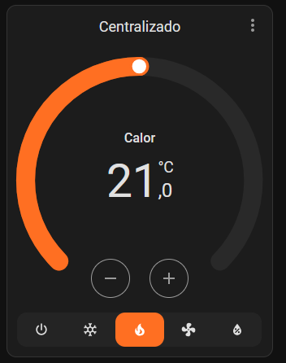

# ❄️ DKN Cloud for Home Assistant

**Control Daikin Airzone Cloud HVAC systems from Home Assistant** using your existing account at [dkn.airzonecloud.com](https://dkn.airzonecloud.com/). Built primarily for the **DAIKIN ES.DKNWSERVER Wi-Fi adapter**.

> **Unofficial integration:** Community-maintained; not affiliated with or endorsed by Daikin or Airzone. A working DKN Cloud account and internet connectivity are required.

**[Releases](https://github.com/eXPerience83/DKNCloud-HASS/releases)** · **[MIT license](./LICENSE)**

## Features

- **Climate control:** Power, cooling, heating, ventilation, dehumidification, target temperature and supported fan speeds.
- **Native presets:** `home`, `away` and `sleep` on each climate entity. No separate `select.scenary` entity.
- **Sleep and away settings:** Configurable sleep timer and minimum/maximum unoccupied temperatures. Wake commands exit a stale Sleep scene. A session-consistent ON→OFF transition also initiates one guarded Home cleanup by default, without waiting for timer expiry. Two real one-shot Sleep cycles and cleanup were verified on a test device.
- **Status and diagnostics:** Room temperature, device power, connection status, last connection and other available device data. Connection monitoring is passive (no additional pings).
- **Privacy by default:** Identifiers such as MAC, PIN and installation/location are only exposed by opting in; those entities remain disabled by default.
- **Localized UI:** English, Spanish, French, German, Italian and Portuguese.

Some features depend on your device and firmware. Experimental `HEAT_COOL` control is **disabled by default** and must be explicitly enabled.

## Installation

Install through the **built-in Marketplace in Home Assistant 2026.11 or newer**. Automated checks now pass on the locked HA 2026.11 baseline, including a separate hash-locked minimum-version test suite, but **real-device and native Marketplace/HACS migration acceptance are still pending**. An optional alpha prerelease is not a stable compatibility certification. See the [validation checklist](./docs/ha-2026.11-smoke.md).

### Install with Marketplace

1. Open **Settings → Marketplace** in Home Assistant.
2. Find **DKN Cloud for Home Assistant** and install it.
3. Restart if prompted, then go to **Settings → Devices & Services → Add Integration** and select **DKN Cloud for Home Assistant**.

**Published versions:** Check [GitHub Releases](https://github.com/eXPerience83/DKNCloud-HASS/releases) for the stable release and optional prereleases. Code on `main` can contain changes **not yet published**; passing CI is not a real-device compatibility certification.

## Configuration

In **Settings → Devices & Services**, add **DKN Cloud for Home Assistant** and enter your DKN Cloud email/username and password. **No YAML is required.**

Optional settings in the Home Assistant UI:

- **Automatic synchronization:** The integration owns its fixed nominal cadence and recovery; no scan interval option is exposed.
- **Expose PII identifiers:** Add sensitive identifier entities (off by default; the entities themselves are disabled by default).
- **Experimental HEAT_COOL:** Only when the device advertises support; this mode is not broadly validated on hardware.
- **Automatic Sleep cleanup:** Enabled by default and configurable. When a current Sleep session reports ON then a confirmed OFF, send one guarded `occupied` write; disable to leave the backend scene unchanged. Manual Home/wake remains available. An ON anomaly after the expected timer plus five minutes is read-only and included in sanitized diagnostics.

## Available entities

| Entity | Purpose |
| --- | --- |
| **Climate** | Modes `COOL`, `HEAT`, `FAN_ONLY`, `DRY`; supported fan speeds, setpoints and `home/away/sleep` presets |
| **Switch** | Power on/off for each device |
| **Number** | Sleep timer (`sleep_time`), away minimum (`min_temp_unoccupied`, **12–22 °C**) and away maximum (`max_temp_unoccupied`, **24–34 °C**) |
| **Sensor** | Current temperature, last connection and available diagnostic data |
| **Binary sensor** | Device power state and passive WServer connectivity |

The exact entities and available controls vary by device capabilities and configuration.

## Compatibility and limitations

- **Primary target:** DAIKIN ES.DKNWSERVER (Cloud). Other Daikin/Airzone adapters are not guaranteed to work.
- **Supported climate modes** depend on the device capability bitmask. `HEAT_COOL` is experimental and opt-in; some reported backend modes are telemetry-only.
- **Ventilation and dehumidification** do not expose a target temperature; fan controls in `DRY` are generally unavailable.
- **Slat position** may appear in diagnostic sensors, but slat control is not implemented.
- **Automatic fan-speed controller** is a future/experimental roadmap item, not a standard feature of this integration.
- **Cloud dependency:** State and commands use the DKN Cloud backend, so outages or connectivity problems can temporarily interrupt control.

For the API commands, device modes, capabilities and detailed backend behavior, see [the technical reference](./info.md). For future features, see [open issues](https://github.com/eXPerience83/DKNCloud-HASS/issues).

## FAQ / Troubleshooting

**How do I change Home/Away/Sleep?** Use the climate entity's presets or the Home Assistant `climate.set_preset_mode` service. The old `select.scenary` entity was removed.

**Why does Sleep sometimes remain active after the unit turns off?** Some devices retain the raw Sleep scene after powering off. By default, the integration waits for an independently confirmed ON→OFF in the active session, then writes `occupied` once and verifies backend convergence. This was validated during two real Sleep cycles, but some edge conditions (such as a manual OFF) remain covered synthetically only. If cleanup is disabled, selecting Sleep again while the backend still shows Sleep/OFF explicitly rearms it through `occupied → sleep`.

**Why can't I select HEAT_COOL?** Both the device capability bit and the **Enable experimental HEAT_COOL mode** option are required. Even then, its physical behavior is not fully validated across devices.

**Can I change the fan speed or slats in every mode?** No. Fan settings are capability- and mode-dependent; slat control is not implemented.

**Why is the WServer offline or a command rejected?** Check that the official DKN Cloud service and device are reachable. A failed command can report `DKN WServer not connected (422)`; the integration also exposes passive connectivity sensors.

**What happens when authentication expires?** Home Assistant can request reauthentication. The account password is not persisted; the authentication token is stored in Home Assistant config-entry options, which Home Assistant does not encrypt by default. Avoid exposing diagnostics containing identifiers.

If a problem persists, [open an issue](https://github.com/eXPerience83/DKNCloud-HASS/issues) with your HA/integration versions and **sanitized** logs (never include credentials, MAC addresses or PINs).

## Documentation

- [Technical reference and DKN API](./info.md)
- [Development, testing and CI](./docs/development.md)
- [Contributing](./CONTRIBUTING.md)
- [Releasing](./RELEASING.md)
- [Home Assistant 2026.11 compatibility checklist](./docs/ha-2026.11-smoke.md)
- [Changelog](./CHANGELOG.md)

## Support and credits

Contributions and translations are welcome. If you find this useful, you can support the project via [Ko-fi](https://ko-fi.com/experience83) or [PayPal](https://paypal.me/eXPerience83).

Inspired by [AirzoneCloudDaikin](https://pypi.org/project/AirzoneCloudDaikin/) and the [original Home Assistant integration by max13fr](https://github.com/max13fr/AirzoneCloudDaikin). Thanks to their authors.

## License

[MIT](./LICENSE) © eXPerience83. Daikin and Airzone are trademarks of their respective owners.
