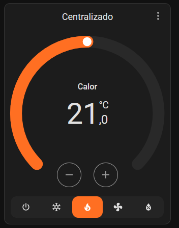

# ❄️ DKN Cloud for HASS

**Control your Daikin Airzone Cloud (dkn.airzonecloud.com) HVAC systems natively from Home Assistant.**  
Optimized for the "DAIKIN ES.DKNWSERVER Wi-Fi adapter" — climate, fan, diagnostics, and temperature at your fingertips.

<!-- Badges -->
[](https://github.com/eXPerience83/DKNCloud-HASS/releases)
[](https://github.com/eXPerience83/DKNCloud-HASS/actions/workflows/hassfest.yml)
[](https://github.com/eXPerience83/DKNCloud-HASS/actions/workflows/validate.yml)
[](https://github.com/eXPerience83/DKNCloud-HASS/actions/workflows/lint.yml)
[](https://github.com/eXPerience83/DKNCloud-HASS/security/code-scanning)
[](./LICENSE)
[](https://github.com/hacs/default/blob/master/integration)
[](https://www.python.org/)
[](https://ko-fi.com/experience83)
[](https://paypal.me/eXPerience83)

[](https://my.home-assistant.io/redirect/hacs_repository/?owner=eXPerience83&repository=DKNCloud-HASS&category=integration)

---

## 🚀 Features

- **Fully integrated climate control:**
  Power, mode (heat/cool/fan/dry, optional HEAT_COOL), target temperature, and fan speed for each unit.
- **Native climate presets:**  
  Use Home Assistant **preset modes** (`home`, `away`, `sleep`) directly on the climate entity.  
  The integration maps these presets to backend fields internally — **no `select.scenary` entity**.
- **Automatic device/sensor creation:**  
  Creates climate, temperature, diagnostic, and connectivity entities for each device.
- **Sleep timer & unoccupied limits:**
  Tune **Sleep time** via `number.sleep_time`, **unoccupied min/max** via `number.min_temp_unoccupied` / `number.max_temp_unoccupied`.
- **Privacy-sensitive sensors (opt-in):**
  **MAC**, **PIN**, **installation/location** and related fields are available **only** when the **Expose PII identifiers** option is enabled.
  These sensors are **not diagnostic**, remain **disabled by default**, and should be used with care.

### Sleep scenary handling

- The backend keeps reporting **Sleep** even after the timer finishes and the unit powers off.
  The integration now **auto-exits Sleep** before any HA-driven wake action (turn on, mode
  changes from off, main power switch).
- An **opt-in timeout** treats long-running Sleep sessions as **Home** in the UI and also
  sends a one-off scenary cleanup to the backend (best effort) once the configured sleep time
  plus a grace period has elapsed. Leave it disabled to mirror raw backend state.
- Timeout handling only applies when the device exposes a valid `sleep_time` (via
  `number.*_sleep_time`) greater than zero; otherwise the backend’s native state remains the
  source of truth and no local expiry is applied.

### Passive connectivity monitor

- The integration exposes `sensor.<id>_last_connection` (timestamp, enabled by default) and `binary_sensor.<id>_wserver_online` (connectivity, enabled by default).
- Online/offline is derived **passively** from the age of `connection_date` (no extra pings).
- Offline detection uses a fixed **10-minute** internal threshold with a **90 s** debounce shared between connectivity sensors and persistent notifications.
- When a control request fails with HTTP **422**, Home Assistant shows: **“DKN WServer not connected (422)”**.

---

## 🧭 Mode Mapping

| P2 Value | Home Assistant Mode    | Description                                                     |
|----------|------------------------|-----------------------------------------------------------------|
| `"1"`    | COOL                   | Cooling (setpoint via **P7**, fan via **P3**).                  |
| `"2"`    | HEAT                   | Heating (setpoint via **P8**, fan via **P4**).                  |
| `"3"`    | FAN_ONLY               | Ventilation (cold-type fan, sent with **P3**).                  |
| `"4"`    | HEAT_COOL *(opt-in)*   | Experimental dual logic; single setpoint (**P7**) + fan (**P3**). |
| `"5"`    | DRY                    | Dehumidify (no temperature or fan controls).                    |
| `"6"`    | — *(telemetry only)*   | "Cool air" variant; shown as **unknown** in Home Assistant.     |
| `"7"`    | — *(telemetry only)*   | "Heat air" variant; shown as **unknown** in Home Assistant.     |
| `"8"`    | FAN_ONLY (fallback)    | Heat-type ventilation fallback (fan commands routed to **P4**). |

> **About HEAT_COOL (API label “heat-cold-auto”)**
> This mode is **opt-in and experimental/beta**. It appears only when both the device bitmask exposes bit 3 and the new option **Enable experimental HEAT_COOL mode** is enabled. While active, the integration always uses **P7** for the setpoint and **P3** for fan speed.

---

## ⚙️ Installation

### Home Assistant 2026.11+ — built-in Marketplace (recommended)
1. Open **Settings → Marketplace** in Home Assistant (no separate HACS installation).
2. Find **DKN Cloud for HASS** in the integration catalog and install it.
3. Follow any restart prompt, then open **Settings → Devices & Services → Add Integration** and search for **DKN Cloud for HASS**.

[](https://my.home-assistant.io/redirect/marketplace_repository/?owner=eXPerience83&repository=DKNCloud-HASS&category=integration)

### Home Assistant 2026.10.4–2026.10.x — HACS
1. Open **HACS → Integrations**, search for **DKN Cloud for HASS**, and install.
2. Restart if prompted, then add **DKN Cloud for HASS** under **Settings → Devices & Services**.

The [existing HACS link](https://my.home-assistant.io/redirect/hacs_repository/?owner=eXPerience83&repository=DKNCloud-HASS&category=integration) also forwards to Marketplace from HA 2026.11 onward. Existing HACS-installed integrations are migrated by Home Assistant. Both use the same `hacs.json` and GitHub release ZIP.

**Release availability:** `v0.5.0a2` is a **pre-release** and is available only to users who opt into pre-releases; the regular stable channel does not automatically receive this alpha. Do not treat CI success as real-device validation or a stable release.

[](https://my.home-assistant.io/redirect/config_flow_start/?domain=airzoneclouddaikin)

> **Manual (advanced; not needed when using Marketplace/HACS):**  
> Copy `custom_components/airzoneclouddaikin/` into your `<config>/custom_components/` folder and restart.

---

## 🔧 Configuration

After installation, go to **Settings → Devices & Services → Add Integration** and search for **DKN Cloud for HASS**.  
Enter your Airzone Cloud **username** and **password**.

**Optional parameters:**
- **Scan interval:** Data refresh interval (seconds, default: 10)
- **Expose PII identifiers:** When enabled, creates extra privacy-sensitive sensors
  (MAC, PIN, installation/location, etc.). Disabled by default.

> **No YAML required!**  
> All options are set via the Home Assistant UI.

---

## 🏷️ What You Get

- **Climate entity:**
  - Modes: COOL, HEAT, FAN_ONLY, DRY (+ optional HEAT_COOL when enabled)
  - Dynamic fan speed control
  - **Preset modes**: `home`, `away`, `sleep` (use `climate.set_preset_mode`)
- **Sensor entities:**
  - Current temperature (`local_temp`)
  - Sleep timer (minutes)
  - Diagnostics: modes, program status, slats, HEAT_COOL compatibility (opt-in)
- **Switch entity:**  
  - Power ON/OFF per device
- **Number entities (config):**  
  - `number.min_temp_unoccupied` (**12–22 °C**)  
  - `number.max_temp_unoccupied` (**24–34 °C**)  
  - `number.sleep_time` (**minutes**)
- **Binary sensor entities:**
  - `binary_sensor.<id>_device_on` — reflects the device power state (enabled by default)
  - `binary_sensor.<id>_wserver_online` — passive connectivity status (enabled by default)

> Full API/command mapping and advanced usage in [info.md](./info.md).

## 🌐 Localizations

- UI strings are localized for **English, Spanish, French, German, Italian, and Portuguese**.
- Translation coverage tests ensure new strings stay in sync across locales.

---

## 📷 Screenshots



---

## 🧪 Compatibility

| Home Assistant | Python   | Daikin Model/Adapter         |
|----------------|----------|------------------------------|
| **2026.10.4+** | **3.14+** | DAIKIN ES.DKNWSERVER (Cloud) |

*Other Airzone or Daikin adapters may not be supported.*

---

## 🛣️ Roadmap

- [ ] **HEAT_COOL (opt-in)** — ongoing validation across devices/firmwares before enabling by default
- [ ] **Auto Fan Speed (opt-in, experimental)** — controller that selects fan speed (e.g., **P3/P4**) based on **ΔT** (discrete **1 °C** steps & hysteresis), active only in **HEAT/COOL**

---

## ❓ FAQ / Troubleshooting

**Q: How do I change scenes/presets?**  
A: Use **climate presets** on the climate entity (`preset_modes`: `home`, `away`, `sleep`) and the service **`climate.set_preset_mode`**. This supersedes the legacy `select.scenary` entity.

**Q: Will HEAT_COOL (API label “heat-cold-auto”) be supported?**
A: Yes — it is available as an **opt-in experimental** mode. When enabled, the integration uses **P7** for the single setpoint and **P3** for fan commands, mirroring the cold-channel behavior recommended by Daikin/Airzone. Compatibility still depends on the device bitmask and firmware.

**Q: Will there be an automatic fan speed?**  
A: Planned/experimental. It will adapt fan speed (e.g., **P3/P4**) to the **ΔT** with **1 °C** thresholds and **hysteresis**, only in **HEAT/COOL**.

**Q: Can I control vertical/horizontal slats?**  
A: Slat state/position is shown in diagnostic sensors; control is not implemented.

**Q: Where can I find advanced API usage, all device fields, and curl examples?**  
A: See [info.md](./info.md).

---

## 🧪 Reproducible tests and development

The locked test baseline runs on **Python 3.14.10**, with
**Home Assistant 2026.10.4** and
`pytest-homeassistant-custom-component==0.13.375`.
All test and lint dependencies (including transitives) are recorded in
`uv.lock`. Home Assistant 2026.10.4 is also the **minimum supported version**
for the next release built from this source. Installations running older Home
Assistant versions must upgrade HA before installing that release; earlier
published DKN releases keep their own version-specific compatibility metadata.
This deliberate breaking change does not rename entities or migrate config entries.

Install [uv](https://docs.astral.sh/uv/), then run:

```sh
uv lock --check
uv sync --locked --only-group release
uv run --locked --no-sync python -m pytest -q
uv run --locked --no-sync ruff check .
uv run --locked --no-sync black --check .
```

The `test` group contains the Home Assistant test harness, `lint`
contains Black and Ruff, and `release` combines both. `pytest-asyncio` is
installed **transitively** at the exact version required by PHACC; it must
not be upgraded separately because PHACC pins it for its HA test stack.
Renovate only proposes PyPI updates after the **same 3-day maturity delay**
that `uv` enforces through `exclude-newer`, and it rebases proposals when
`main` advances. HA and PHACC are excluded from ordinary Renovate updates:
those versions are managed **together**, with review, under the
[compatibility roadmap #109](https://github.com/eXPerience83/DKNCloud-HASS/issues/109). The previous
unbounded `requirements_test.txt` was removed to prevent conflicting
dependency resolution. The release ZIP still contains only
`custom_components/airzoneclouddaikin`.

The **required** [locked HA test workflow](https://github.com/eXPerience83/DKNCloud-HASS/actions/workflows/tests.yml) exercises Home Assistant 2026.10.4 / PHACC 0.13.375 on Python 3.14.10. Because the supported minimum and locked baseline now coincide, the former separate HA 2026.3.1 test job and its independent hash-lock have been removed to avoid running the same suite twice. CI checks that `hacs.json` agrees with the locked Home Assistant test version. If the locked baseline advances while the minimum stays at 2026.10.4, that check intentionally fails until an independently locked minimum-version test is restored. Python 3.15 remains unvalidated for this HA/PHACC harness.

A **separate [daily Home Assistant compatibility canary](https://github.com/eXPerience83/DKNCloud-HASS/actions/workflows/ha-compatibility-canary.yml)** runs at **04:47 UTC** and can be launched manually. It selects the newest **stable, non-yanked** HA version with a matching stable `pytest-homeassistant-custom-component` release, skips HA prereleases and reports when the harness trails the latest stable HA. It installs the selected pair in an isolated virtual environment and runs the **same full pytest suite**, with no credentials or DKN cloud access. Canary failures reveal compatibility problems but **do not block PR CI, update `uv.lock`, or trigger automatic dependency updates**. It runs on the pinned Python 3.14 baseline; if a future HA requires another Python version, the installation failure will be visible rather than silently widening support.

### DKN-specific coverage and regression testing

The first measured baseline in phase 5 (before adding DKN command/lifecycle
tests) was **69.62% statement coverage across 2,097 executable statements**
(167 passing tests). In particular, `climate.py` began at **47.56%**,
`airzone_api.py` at **72.78%**, and the integration coordinator (`__init__.py`)
at **70.17%**. These are observations from the pinned Python 3.14.7 /
HA 2026.10.4 harness, **not claims of completeness or real-device coverage**.
After the new lifecycle, command and API contract tests, the same harness passed
**204 tests** with **75.54%** global coverage, including **69.14%** in
`climate.py`, **75.56%** in `airzone_api.py` and **74.95%** in `__init__.py`.
The incremental gates are **74% global**, **65% climate**, **75% API** and
**73% coordinator** — deliberately below measured values with a modest margin.

The normal locked **current-HA** test workflow runs pytest-cov and uploads
`coverage.json` and `coverage.xml` as a downloadable GitHub Actions artifact.
Its GitHub Step Summary shows per-module statement counts and flags regressions
below incremental, evidence-based floors. The independently hash-locked minimum-HA
workflow still runs the **same full suite** without needing pytest-cov (to avoid
unreviewed changes to its fixed dependency graph). Run locally with:

```sh
uv lock --check
uv sync --locked --only-group test
uv run --locked --no-sync python -m pytest -q \
  --cov=custom_components.airzoneclouddaikin \
  --cov-report=term-missing:skip-covered \
  --cov-report=xml:coverage.xml \
  --cov-report=json:coverage.json
uv run --locked --no-sync python scripts/check_coverage.py \
  coverage.json --min-total 74.0 \
  --module-min __init__.py=73.0 \
  --module-min airzone_api.py=75.0 \
  --module-min climate.py=65.0
```

Added regression cases use only deterministic synthetic data, HA's in-memory
test harness and local loopback HTTP. They exercise real HA entry setup,
entity/device registries, unload/reload/restart simulation, legacy entry migration,
concurrent installation collection and cancellation, HTTP error/retry handling,
and DKN `P1/P3/P4/P7/P8` climate commands. **No public CI test authenticates
against the Airzone service or uses real MACs, PINs or account credentials.**
The HACS/Marketplace installation and physical backend convergence still require
separate manual smoke evidence. The current runtime has no separate
`infomaquina` HTTP endpoint; `GET /devices`, `POST /events` and P-channel
write contracts are exercised with synthetic data. See [#121](https://github.com/eXPerience83/DKNCloud-HASS/issues/121)
and hardware-gated [#102](https://github.com/eXPerience83/DKNCloud-HASS/pull/102).

A **[daily reviewed baseline updater](https://github.com/eXPerience83/DKNCloud-HASS/actions/workflows/ha-test-baseline-updater.yml)** checks the stable, non-yanked HA/PHACC pair at **06:43 UTC**, independently of the daily compatibility canary. It derives the maturity policy from the existing `[tool.uv].exclude-newer = "3 days"` setting, **requires both HA and PHACC releases to age at least three days**, and never upgrades only one side of an exact-match harness pair. No prerelease or yanked build is promoted; PHACC lag is reported without claiming the latest HA was tested.

When a pair is mature, the updater tests a **proposed** `pyproject.toml` + `uv.lock` in an isolated validation job: the delta must be confined to the HA/PHACC dependency graph, `uv lock --check`, the full pytest suite, Ruff and Black must pass. Only then may a separate narrowly permissioned job open **one review-only PR**. Its artifact is hash-verified, its branch is unique per version pair, and it rejects duplicate PRs, failed validation and a moved `main`. **No automerge** or automatic release is enabled, and `.github/requirements/minimum-ha.*`, `hacs.json` and runtime integration code remain untouched. With manual **Run workflow**, `publish=false` performs a read-only dry run; selecting `publish=true` may propose a PR only when run from `main`.

The existing baseline remains pinned until that PR is reviewed and merged; published Marketplace packages are not changed by this automation. Python 3.15 forward-compatibility and further regression coverage remain separate [roadmap #109](https://github.com/eXPerience83/DKNCloud-HASS/issues/109) tasks.

## 🤝 How to Contribute

PRs for features, **translations**, and fixes are welcome!

- Open issues and PRs in [GitHub Issues](https://github.com/eXPerience83/DKNCloud-HASS/issues)  
- For **translations**: contribute keys under `translations/` per HA guidelines  
- Follow the code style enforced by **Ruff** and **Black** (see CI)

---

## ❤️ Contributing & Support

If you find this integration useful, you can support development via:

- [Ko-fi](https://ko-fi.com/experience83)  
- [PayPal](https://paypal.me/eXPerience83)

---

### Networking & Reliability

This integration uses a per-request timeout of **30 s** and **exponential backoff with jitter** for `429/5xx`.
If the backend is temporarily unavailable, Home Assistant retries the config entry (**ConfigEntryNotReady**).
For privacy, logs **never** print your email or token.

---

### Authentication & Privacy

Starting with **0.4.0**:
- The legacy `select.scenary` entity is **removed**. Use climate **preset modes**: `home`, `away`, `sleep`.
- The login token is stored in `config_entry.options['user_token']`. **Home Assistant does not encrypt `config_entries` (`data` or `options`) by default**; we keep the token in Options to separate identity data (in `data`) from credentials-like settings and to reduce churn when editing options. Passwords are never persisted.

> Reauth: You’ll be asked for the account password only if the backend returns HTTP 401 or the token becomes invalid.

---

## 🙏 Acknowledgments

This project was inspired by and originally based on:

- [AirzoneCloudDaikin (PyPI)](https://pypi.org/project/AirzoneCloudDaikin/) and its Home Assistant integration by [max13fr](https://github.com/max13fr/AirzoneCloudDaikin)

Many thanks to those projects and authors for their groundwork and inspiration!

---

## 📜 License

MIT © [eXPerience83](LICENSE)

> This project is not affiliated with or endorsed by Daikin or Airzone. All trademarks are property of their respective owners.
