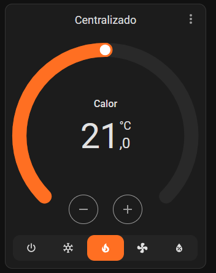

# ❄️ DKN Cloud for Home Assistant

**Control Daikin Airzone Cloud HVAC systems from Home Assistant** using your existing account at [dkn.airzonecloud.com](https://dkn.airzonecloud.com/). Built primarily for the **DAIKIN ES.DKNWSERVER Wi-Fi adapter**.

> **Unofficial integration:** Community-maintained; not affiliated with or endorsed by Daikin or Airzone. A working DKN Cloud account and internet connectivity are required.

**[Releases](https://github.com/eXPerience83/DKNCloud-HASS/releases)** · **[MIT license](./LICENSE)**

## Features

- **Climate control:** Power, cooling, heating, ventilation, dehumidification, target temperature and supported fan speeds.
- **Native presets:** `home`, `away` and `sleep` on each climate entity. No separate `select.scenary` entity.
- **Sleep and away settings:** Configurable sleep timer and minimum/maximum unoccupied temperatures. Wake commands exit a stale Sleep scene. A session-consistent ON→OFF transition also initiates one guarded Home cleanup by default, without waiting for timer expiry. Two real one-shot Sleep cycles and cleanup were verified on a test device.
- **Status and diagnostics:** Room temperature, device power, connection status, last connection, and (starting with 0.6.0b1) a per-device cloud PUSH/REST synchronization-mode sensor. Connection monitoring is passive (no additional pings).
- **Privacy by default:** Identifiers such as MAC, PIN and installation/location are only exposed by opting in; those entities remain disabled by default.
- **Localized UI:** English, Spanish, French, German, Italian and Portuguese.

Some features depend on your device and firmware. Experimental `HEAT_COOL` control is **disabled by default** and must be explicitly enabled.

## Installation

Install through the **built-in Marketplace in Home Assistant 2026.11 or newer**. Automated checks pass on the locked HA 2026.11 baseline, including a separate hash-locked minimum-version test suite. The owner's installed 0.6.0a1 alpha has shown healthy PUSH after a HA 2026.11.2 restart and Marketplace update, but fresh-install / legacy HACS migration, broad hardware control and the first beta still require their own acceptance. **Neither alpha nor beta is stable-certified.** See the [validation checklist](./docs/ha-2026.11-smoke.md).

### Install with Marketplace

1. Open **Settings → Marketplace** in Home Assistant.
2. Find **DKN Cloud for Home Assistant** and install it.
3. Restart if prompted, then go to **Settings → Devices & Services → Add Integration** and select **DKN Cloud for Home Assistant**.

**Published versions:** Check [GitHub Releases](https://github.com/eXPerience83/DKNCloud-HASS/releases) for the stable release and optional prereleases. Code on `main` can contain changes **not yet published**; passing CI is not a real-device compatibility certification.

### 0.6.0b1 experimental beta — what changes from the alpha

Compared with published `0.6.0a1`, the first beta adds a read-only,
per-device **Synchronization Mode** diagnostic that reports cloud
`push`, `rest_fallback`, `resyncing`, `auth_required`, or a transient
`stopped` state. It refreshes through existing local notifications,
including when reauthentication is needed; it does **not** trigger extra
REST requests or indicate whether the physical WServer is online.

No new configuration migration, entity renaming, HVAC command or
Sleep / notification policy change is introduced relative to 0.6.0a1.
The `v0.6.0b1` beta was published on 2026-11-17 as a GitHub prerelease,
not as a stable release. Marketplace installation of this beta and physical
device acceptance still require separate verification.
Back up HA before upgrading, and verify the sensor, existing entities and
normal operation after restarting. Real beta-installation acceptance is
still pending [#191](https://github.com/eXPerience83/DKNCloud-HASS/issues/191).

### 0.6.0a1 alpha baseline — upgrading from earlier versions

The 0.6.0a1 baseline introduces **automatic INFO-driven Pusher updates** with a
nominal 10-second information cycle and budgeted REST GET recovery. Its
default-on, session-guarded Sleep cleanup differs from earlier versions.
It also retires the user-configurable `scan_interval` and the previous local
`sleep_timeout_enabled` Home-display behavior; existing device/entity
identifiers are preserved. The minimum is **Home Assistant 2026.11.0**
(Python 3.14).

**Before upgrading:** Back up Home Assistant, record your currently installed
DKN version and options, and keep a known-good restore path. An integration
downgrade alone may not reverse configuration-option migration; restoring
the pre-upgrade HA backup is the safer rollback path if the alpha misbehaves.
Select the prerelease explicitly when it becomes available, and validate
normal operation before relying on automations. Real Marketplace/HACS upgrade
and physical-device acceptance are still pending [#121](https://github.com/eXPerience83/DKNCloud-HASS/issues/121)
and [#191](https://github.com/eXPerience83/DKNCloud-HASS/issues/191).

## Configuration

In **Settings → Devices & Services**, add **DKN Cloud for Home Assistant** and enter your DKN Cloud email/username and password. **No YAML is required.**

Optional settings in the Home Assistant UI:

- **Automatic synchronization:** The integration owns its fixed nominal cadence and recovery; no scan interval option is exposed.
- **Expose PII identifiers:** Add sensitive identifier entities (off by default; the entities themselves are disabled by default).
- **Experimental HEAT_COOL:** Only when the device advertises support; this mode is not broadly validated on hardware.
- **Automatic Sleep cleanup:** Enabled by default and configurable. When a current Sleep session reports ON then a confirmed OFF, send one guarded `occupied` write; disable to leave the backend scene unchanged. Manual Home/wake remains available. An ON anomaly after the expected timer plus five minutes is read-only and included in sanitized diagnostics.

## Available entities

| Entity | Purpose |
| --- | --- |
| **Climate** | Modes `COOL`, `HEAT`, `FAN_ONLY`, `DRY`; supported fan speeds, setpoints and `home/away/sleep` presets |
| **Switch** | Power on/off for each device |
| **Number** | Sleep timer (`sleep_time`), away minimum (`min_temp_unoccupied`, **12–22 °C**) and away maximum (`max_temp_unoccupied`, **24–34 °C**) |
| **Sensor** | Current temperature, last connection, and diagnostic data including per-device Synchronization Mode |
| **Binary sensor** | Device power state and passive WServer connectivity |

The exact entities and available controls vary by device capabilities and configuration.

### PUSH/REST synchronization diagnostic

Starting with **0.6.0b1**, go to **Settings → Devices & Services → DKN Cloud → Devices**, open a device, and show its **Diagnostic** entities to find **Synchronization Mode** (you can also search Entities for `sync_mode`). The sensor is enabled by default, read-only, and can be disabled in the entity registry.

- `push` — the cloud Pusher/INFO subscription is active.
- `rest_fallback` — automatic REST GET fallback is being used because PUSH is inactive.
- `resyncing` — the subscription is being restored and reconciled.
- `auth_required` — the cloud account needs reauthentication.
- `stopped` — transient teardown state; the entity normally becomes unavailable or is removed on unload.

These are **cloud synchronization transport modes**, not HVAC operating modes or proof that the **physical WServer** is online. The separate WServer connectivity binary sensor and its offline notifications are unchanged. This diagnostic only observes the existing synchronization manager; it adds no requests or polling.

## Compatibility and limitations

- **Primary target:** DAIKIN ES.DKNWSERVER (Cloud). Other Daikin/Airzone adapters are not guaranteed to work.
- **Supported climate modes** depend on the device capability bitmask. `HEAT_COOL` is experimental and opt-in; some reported backend modes are telemetry-only.
- **Ventilation and dehumidification** do not expose a target temperature; fan controls in `DRY` are generally unavailable.
- **Slat position** may appear in diagnostic sensors, but slat control is not implemented.
- **Automatic fan-speed controller** is a future/experimental roadmap item, not a standard feature of this integration.
- **Cloud dependency:** State and commands use the DKN Cloud backend, so outages or connectivity problems can temporarily interrupt control.

For the API commands, device modes, capabilities and detailed backend behavior, see [the technical reference](./info.md). For future features, see [open issues](https://github.com/eXPerience83/DKNCloud-HASS/issues).

## FAQ / Troubleshooting

**How do I change Home/Away/Sleep?** Use the climate entity's presets or the Home Assistant `climate.set_preset_mode` service. The old `select.scenary` entity was removed.

**Why does Sleep sometimes remain active after the unit turns off?** Some devices retain the raw Sleep scene after powering off. By default, the integration waits for an independently confirmed ON→OFF in the active session, then writes `occupied` once and verifies backend convergence. This was validated during two real Sleep cycles, but some edge conditions (such as a manual OFF) remain covered synthetically only. If cleanup is disabled, selecting Sleep again while the backend still shows Sleep/OFF explicitly rearms it through `occupied → sleep`.

**Why can't I select HEAT_COOL?** Both the device capability bit and the **Enable experimental HEAT_COOL mode** option are required. Even then, its physical behavior is not fully validated across devices.

**Why might a wall-controller change appear late in Home Assistant?**
The backend's GET snapshot can temporarily lag the physical equipment.
The new integration sends bounded `infomaquina` information requests and
consumes incoming Pusher updates; GET remains useful for initial state and
recovery, but a successful GET alone is not proof of physical freshness.
External wall-controller latency still needs real-device acceptance
([#101](https://github.com/eXPerience83/DKNCloud-HASS/issues/101)).

**Can I change the fan speed or slats in every mode?** No. Fan settings are capability- and mode-dependent; slat control is not implemented.

**Why is the WServer offline or a command rejected?** Check that the official DKN Cloud service and device are reachable. A failed command can report `DKN WServer not connected (422)`; the integration also exposes passive connectivity sensors.

**What happens when authentication expires?** Home Assistant can request reauthentication. The account password is not persisted; the authentication token is stored in Home Assistant config-entry options, which Home Assistant does not encrypt by default. Avoid exposing diagnostics containing identifiers.

If a problem persists, [open an issue](https://github.com/eXPerience83/DKNCloud-HASS/issues) with your HA/integration versions and **sanitized** logs (never include credentials, MAC addresses or PINs).

## Documentation

- [Technical reference and DKN API](./info.md)
- [Development, testing and CI](./docs/development.md)
- [Contributing](./CONTRIBUTING.md)
- [Releasing](./RELEASING.md)
- [Home Assistant 2026.11 compatibility checklist](./docs/ha-2026.11-smoke.md)
- [Changelog](./CHANGELOG.md)

## Support and credits

Contributions and translations are welcome. If you find this useful, you can support the project via [Ko-fi](https://ko-fi.com/experience83) or [PayPal](https://paypal.me/eXPerience83).

Inspired by [AirzoneCloudDaikin](https://pypi.org/project/AirzoneCloudDaikin/) and the [original Home Assistant integration by max13fr](https://github.com/max13fr/AirzoneCloudDaikin). Thanks to their authors.

## License

[MIT](./LICENSE) © eXPerience83. Daikin and Airzone are trademarks of their respective owners.
